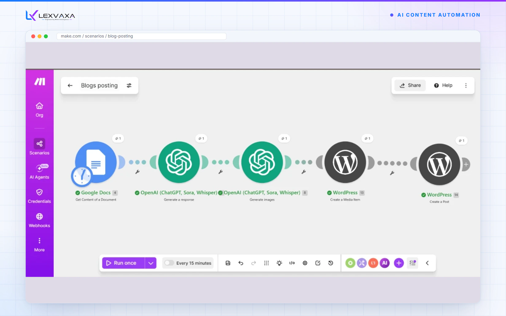

<!-- styled:v2 -->

**An AI workflow that turns source content into SEO blog posts with images and publishes them to WordPress automatically.**

  
  
  
  
  
  
  

  <a href="#overview">Overview</a> ·
  <a href="#key-features">Key features</a> ·
  <a href="#results">Results</a> ·
  <a href="#tech-stack">Tech stack</a>

---

## Overview

Writing, formatting and publishing SEO blog posts by hand took hours every week. Lexvaxa built an AI blog automation in Make that pulls source content from Google Docs, uses OpenAI to write SEO-focused blog content and generate images, creates the media items and publishes the posts to WordPress on a schedule. Screens shown use sample data, so no client records are exposed.

## The challenge

Each blog post meant hours of writing, formatting, image work and manual publishing.

## The solution

A scheduled Make scenario: Google Docs as the source, OpenAI for the article and images, and the WordPress API for media and posts.

## Key features

- Source content pulled from Google Docs
- AI-written SEO blog content
- AI image generation for each post
- Media items created in WordPress
- Posts published automatically on a schedule

## Results

- A scalable content-to-publishing process with fewer manual steps

## Tech stack

    

## Privacy

Client names and records are confidential. Every screen in this repository uses sample data, and source code that belongs to the client is not published.

## Links

- Case study on Lexvaxa: https://lexvaxa.com/work/ai-blog-wordpress-automation

---

**Built by [Ch Muhammad Samiullah](https://github.com/samiullah156-creator)** · AI Automation Engineer and Full-Stack Developer at [Lexvaxa](https://lexvaxa.com)

⭐ Star this repo if you found it useful

